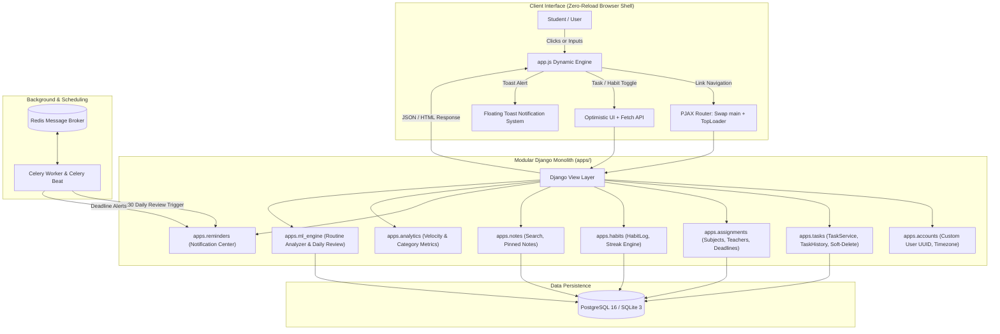
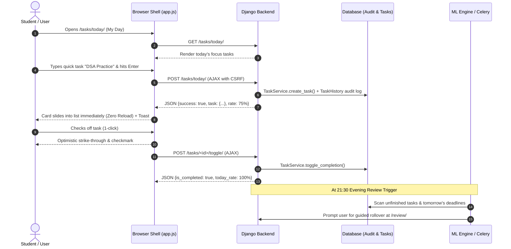

<!-- Stage 2/5: Progressive implementation -->
<div align="center">

# ⚡ My Habit Tracker

**Intelligent Personal Productivity, Academic Deadline Tracking & Hybrid ML Scheduling**

[](https://www.djangoproject.com/)
[](https://www.python.org/)
[](https://opensource.org/licenses/MIT)
[](https://tailwindcss.com/)
[](https://docs.celeryq.dev/)
[](https://scikit-learn.org/)
[](https://github.com/Yashendra-org/Ai_Powered_Task_Manager)

<p align="center">
  <a href="#-overview">Overview</a> •
  <a href="#-key-features">Key Features</a> •
  <a href="#-system-architecture">Architecture</a> •
  <a href="#-workflow">Workflow</a> •
  <a href="#-project-structure">Project Structure</a> •
  <a href="#-technology-stack">Tech Stack</a> •
  <a href="#-installation--setup">Setup</a> •
  <a href="#-api--view-routes">Routes</a> •
  <a href="#-testing--verification">Testing</a> •
  <a href="#-contributors">Contributors</a>
</p>

</div>

---

## 📌 Overview

**My Habit Tracker** is a distraction-free, personal productivity web platform designed specifically for students, self-improvers, and professionals. It unifies daily task prioritization, college assignment deadline management, recurring habit streak tracking, and machine learning routine discovery into one unified workspace.

Traditional to-do apps simply store tasks until they are manually checked off, leading to backlog fatigue, forgotten academic submissions, and abandoned habits. **My Habit Tracker** transforms this paradigm through rule-based automation, a hybrid recommendation engine, and an instantaneous zero-reload user interface.

### The Solution

My Habit Tracker bridges daily execution with long-term consistency through four core pillars:

- **"My Day" Focus Cockpit** — A dedicated daily focus view featuring sticky quick-task addition, live completion rate computation, and 1-click completion toggles that operate without refreshing the page.
- **College Assignment Hub** — Subject and professor directories with dynamic submission urgency categorization (`Due Today`, `Due Soon`, `Overdue`), coursework file uploads, and 1-click submission logs.
- **7-Day Habit Consistency Matrix** — Weekly interactive grid tracking consecutive streaks, daily completions, and visual consistency momentum across customizable frequencies.
- **Intelligent Assistant & Daily Review** — Hybrid recommendation system (routine frequency detection + deadline risk alerts + feedback loop) coupled with a 21:30 guided End-of-Day Review for seamless task rollover.

> [!NOTE]
> **Zero-Reload SPA Architecture**: The application incorporates a seamless client-side PJAX and AJAX engine. Task toggling, habit logging, assignment submission, note pinning, and sidebar page transitions occur instantaneously with zero white screen flashes or page reloads.

---

## ✨ Key Features

### 📅 Daily Task Management & "My Day"
| | Feature | Details |
|---|---|---|
| ☀️ | **"My Day" Focus View** | Focused daily cockpit displaying only tasks scheduled for today with real-time progress bars |
| ⚡ | **Zero-Reload Quick Add** | Sticky inline input bar that inserts newly created tasks directly into the DOM with smooth animations |
| 🔄 | **1-Click Completion Toggle** | Instant check/uncheck status switching with optimistic strike-through styling and recalculation |
| 🗂️ | **Multi-Criteria Task Filtering** | Filter "All Tasks" by status (`Pending`, `Completed`, `Overdue`), Category pills, Priority, and Search query |
| 🗑️ | **Soft-Delete & Trash Recovery** | Accidental deletions move tasks to Recently Deleted (`/tasks/trash/`) with 1-click restore |
| ⏱️ | **Audit History Tracking** | Automatic state logging (`TaskHistory`) recording all transitions for ML model training data |

### 🎓 College Assignment Manager
| | Feature | Details |
|---|---|---|
| 📚 | **Academic Subject Directory** | Course code and subject catalog (e.g. `CS302 — Data Structures`) with color-coded badges |
| 👨‍🏫 | **Instructor Directory** | Teacher contact registry linking office locations, emails, and assigned subjects |
| 🚨 | **Dynamic Urgency Badges** | Automated deadline categorizer highlighting `Due Today`, `Due Soon (<48h)`, and `Overdue` submissions |
| 📎 | **Coursework File Uploads** | Attach homework PDFs, code archives, or problem sets directly to assignment records |
| ✅ | **1-Click Submission Toggle** | Mark assignments as "Submitted" with timestamp logging (`submitted_at`) without page reloads |

### 🔥 Habit Tracker & Quick Notes
| | Feature | Details |
|---|---|---|
| 🗓️ | **7-Day Consistency Matrix** | Horizontal weekly grid (Mon–Sun) with instant check-off buttons for each active habit |
| 📈 | **Streak Counter Engine** | Real-time calculation of consecutive active days (`current_streak`) with milestone badges |
| 📝 | **Quick Notes Scratchpad** | Card-based notes repository with live full-text search and pin-to-top toggles |
| 🏷️ | **Custom Recurrence Schedules** | Daily, Weekday, Weekend, or custom-day recurring habit scheduling rules |

### 🧠 Smart Assistant & End-of-Day Review
| | Feature | Details |
|---|---|---|
| 🤖 | **Routine Detection Engine** | Scans historical `TaskHistory` to identify recurring weekly patterns and propose automatic task scheduling |
| ⚠️ | **Completion Likelihood Alerts** | Flags high-urgency tasks and assignments at risk of slipping past deadlines |
| 🌙 | **Guided Evening Review** | 21:30 daily recap view at `/review/` allowing 1-click rollover to tomorrow or cancellation |
| 💬 | **Accept / Reject Feedback Loop** | Feedback records (`accepted`, `rejected`) refine future suggestions and auto-create approved tasks |

### 📊 Unified Calendar & Productivity Analytics
| | Feature | Details |
|---|---|---|
| 🗓️ | **Unified Monthly Calendar** | Merges daily scheduled tasks, academic assignment deadlines, and habit completions into one interactive calendar |
| 📊 | **Chart.js Velocity Chart** | 7-day completion velocity bar chart illustrating daily output and productivity momentum |
| 🍩 | **Category Doughnut Chart** | Visual breakdown of time and tasks allocated across academic, personal, and work domains |
| 🔒 | **Multi-Tenant Data Isolation** | Strict `user=request.user` query scoping across all views preventing cross-account data leakage |

---

## 🧱 System Architecture



---

## 🔄 Workflow



---

## 📂 Project Structure

```
AI_powered_Task_Manager/
├── config/                          # Core project settings & configuration
│   ├── settings.py                  # Environment config, WhiteNoise, DB switch, Celery
│   ├── urls.py                      # Root URL routing table
│   ├── celery.py                    # Celery application & beat schedule definitions
│   ├── wsgi.py                      # Production WSGI application
│   ├── asgi.py                      # ASGI application
│   └── __init__.py
│
├── apps/                            # Modular domain applications
│   ├── accounts/                    # Custom User (UUID, Timezone, Review Time)
│   │   ├── models.py, views.py, urls.py, forms.py, admin.py, tests.py
│   │   └── management/commands/seed_dev_data.py
│   │
│   ├── tasks/                       # Core daily tasks & categories
│   │   ├── models.py                # Task, Category, TaskHistory (Audit)
│   │   ├── services.py              # TaskService business logic & state transitions
│   │   ├── views.py                 # My Day, All Tasks, Soft-Delete & Trash
│   │   ├── calendar_views.py        # Monthly unified calendar renderer
│   │   ├── forms.py, urls.py, admin.py, tests.py
│   │   └── migrations/
│   │
│   ├── assignments/                 # Academic assignment tracker
│   │   ├── models.py                # Subject, Teacher, Assignment, File Attachments
│   │   ├── views.py                 # Assignment hub, subject/teacher directory
│   │   ├── forms.py, urls.py, admin.py, tests.py
│   │   └── migrations/
│   │
│   ├── habits/                      # Recurring habit consistency & streaks
│   │   ├── models.py                # Habit, HabitLog
│   │   ├── views.py                 # 7-day weekly matrix, 1-click check-off
│   │   ├── forms.py, urls.py, admin.py, tests.py
│   │   └── migrations/
│   │
│   ├── notes/                       # Quick scratchpad notes
│   │   ├── models.py                # Note (pinned, markdown content)
│   │   ├── views.py                 # Searchable card grid, pin-to-top
│   │   └── forms.py, urls.py, admin.py, tests.py
│   │
│   ├── reminders/                   # In-app notifications & Celery alerts
│   │   ├── models.py                # Reminder, Notification
│   │   ├── views.py                 # Notification center, mark-as-read
│   │   └── urls.py, admin.py, tests.py
│   │
│   ├── analytics/                   # Productivity intelligence & Chart.js
│   │   ├── views.py                 # 7-day velocity chart, category breakdown
│   │   └── urls.py, admin.py, tests.py
│   │
│   └── ml_engine/                   # Hybrid recommendations & daily review
│       ├── models.py                # MLRecommendation, DailySummary
│       ├── services.py              # RecommendationEngine (Pattern Analysis)
│       ├── views.py                 # End-of-Day Review (/review/), Smart Assistant
│       └── urls.py, admin.py, tests.py
│
