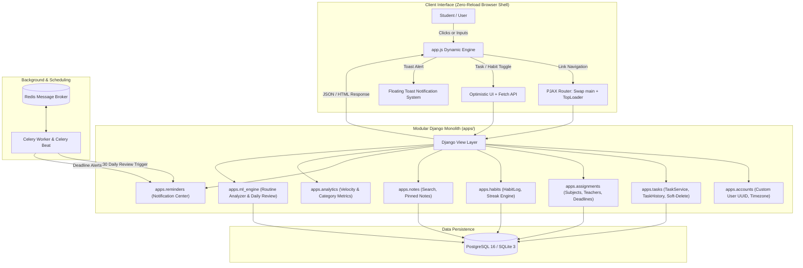
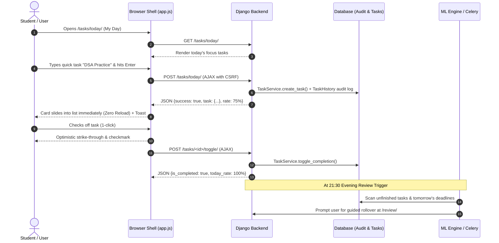

<div align="center">

# ⚡ My Habit Tracker

**Intelligent Personal Productivity, Academic Deadline Tracking & Hybrid ML Scheduling**

[](https://www.djangoproject.com/)
[](https://www.python.org/)
[](https://opensource.org/licenses/MIT)
[](https://tailwindcss.com/)
[](https://github.com/Yashendra-org/Ai_Powered_Task_Manager)
[](https://github.com/Yashendra-org/Ai_Powered_Task_Manager)
[](https://github.com/Yashendra-org/Ai_Powered_Task_Manager)

<p align="center">
  <a href="#-overview">Overview</a> •
  <a href="#-key-features">Key Features</a> •
  <a href="#-modernized-professional-url-architecture">URL Architecture</a> •
  <a href="#-system-architecture">Architecture</a> •
  <a href="#-workflow">Workflow</a> •
  <a href="#-project-structure">Project Structure</a> •
  <a href="#-security--enterprise-hardening">Security</a> •
  <a href="#-technology-stack">Tech Stack</a> •
  <a href="#-installation--setup">Setup</a> •
  <a href="#-testing--verification">Testing</a> •
  <a href="#-contributors">Contributors</a>
</p>

</div>

---

## 📌 Overview

**My Habit Tracker** is a distraction-free, personal productivity web platform designed specifically for students, self-improvers, and professionals. It unifies daily task prioritization, college assignment deadline management, recurring habit streak tracking, and machine learning routine discovery into one unified workspace.

Traditional to-do apps simply store tasks until they are manually checked off, leading to backlog fatigue, forgotten academic submissions, and abandoned habits. **My Habit Tracker** transforms this paradigm through rule-based automation, a hybrid recommendation engine, and an instantaneous zero-reload user interface.

### The Solution

My Habit Tracker bridges daily execution with long-term consistency through four core pillars:

- **"My Day" Focus Cockpit** — A dedicated daily focus view featuring sticky quick-task addition, live completion rate computation, and 1-click completion toggles that operate without refreshing the page.
- **College Assignment Hub** — Subject and professor directories with dynamic submission urgency categorization (`Due Today`, `Due Soon`, `Overdue`), coursework file uploads, and 1-click submission logs.
- **7-Day Habit Consistency Matrix** — Weekly interactive grid tracking consecutive streaks, daily completions, and visual consistency momentum across customizable frequencies.
- **Intelligent Assistant & Daily Review** — Hybrid recommendation system (routine frequency detection + deadline risk alerts + feedback loop) coupled with a 21:30 guided End-of-Day Review for seamless task rollover.

> [!NOTE]
> **Zero-Reload SPA Architecture**: The application incorporates a seamless client-side PJAX and AJAX engine. Task toggling, habit logging, assignment submission, note pinning, and sidebar page transitions occur instantaneously with zero white screen flashes or page reloads.

---

## ✨ Key Features

### 📅 Daily Task Management & "My Day"
| | Feature | Details |
|---|---|---|
| ☀️ | **"My Day" Focus View** | Focused daily cockpit displaying only tasks scheduled for today with real-time progress bars |
| ⚡ | **Zero-Reload Quick Add** | Sticky inline input bar that inserts newly created tasks directly into the DOM with smooth animations |
| 🔄 | **1-Click Completion Toggle** | Instant check/uncheck status switching with optimistic strike-through styling and recalculation |
| 🗂️ | **Multi-Criteria Task Filtering** | Filter "All Tasks" by status (`Pending`, `Completed`, `Overdue`), Category pills, Priority, and Search query |
| 🗑️ | **Soft-Delete & Trash Recovery** | Accidental deletions move tasks to Recently Deleted (`/tasks/trash/`) with 1-click restore |
| ⏱️ | **Audit History Tracking** | Automatic state logging (`TaskHistory`) recording all transitions for ML model training data |

### 🎓 College Assignment Manager
| | Feature | Details |
|---|---|---|
| 📚 | **Academic Subject Directory** | Course code and subject catalog (e.g. `CS302 — Data Structures`) with color-coded badges |
| 👨‍🏫 | **Instructor Directory** | Teacher contact registry linking office locations, emails, and assigned subjects |
| 🚨 | **Dynamic Urgency Badges** | Automated deadline categorizer highlighting `Due Today`, `Due Soon (<48h)`, and `Overdue` submissions |
| 📎 | **Coursework File Uploads** | Attach homework PDFs, code archives, or problem sets directly to assignment records |
| ✅ | **1-Click Submission Toggle** | Mark assignments as "Submitted" with timestamp logging (`submitted_at`) without page reloads |

### 🔥 Habit Tracker & Quick Notes
| | Feature | Details |
|---|---|---|
| 🗓️ | **7-Day Consistency Matrix** | Horizontal weekly grid (Mon–Sun) with instant check-off buttons for each active habit |
| 📈 | **Streak Counter Engine** | Real-time calculation of consecutive active days (`current_streak`) with milestone badges |
| 📝 | **Quick Notes Scratchpad** | Card-based notes repository with live full-text search and pin-to-top toggles |
| 🏷️ | **Custom Recurrence Schedules** | Daily, Weekday, Weekend, or custom-day recurring habit scheduling rules |

### 🧠 Smart Assistant & End-of-Day Review
| | Feature | Details |
|---|---|---|
| 🤖 | **Routine Detection Engine** | Scans historical `TaskHistory` to identify recurring weekly patterns and propose automatic task scheduling |
| ⚠️ | **Completion Likelihood Alerts** | Flags high-urgency tasks and assignments at risk of slipping past deadlines |
| 🌙 | **Guided Evening Review** | 21:30 daily recap view at `/review/` allowing 1-click rollover to tomorrow or cancellation |
| 💬 | **Accept / Reject Feedback Loop** | Feedback records (`accepted`, `rejected`) refine future suggestions and auto-create approved tasks |

### 📊 Unified Calendar & Productivity Analytics
| | Feature | Details |
|---|---|---|
| 🗓️ | **Unified Monthly Calendar** | Merges daily scheduled tasks, academic assignment deadlines, and habit completions into one interactive calendar |
| 📊 | **Chart.js Velocity Chart** | 7-day completion velocity bar chart illustrating daily output and productivity momentum |
| 🍩 | **Category Doughnut Chart** | Visual breakdown of time and tasks allocated across academic, personal, and work domains |
| 🔒 | **Multi-Tenant Data Isolation** | Strict `user=request.user` query scoping across all views preventing cross-account data leakage |

---

## 🧱 System Architecture



---

## 🔄 Workflow



---

## 📂 Project Structure

```
AI_powered_Task_Manager/
├── config/                          # Core project settings & configuration
│   ├── settings.py                  # Environment config, WhiteNoise, DB switch, Celery
│   ├── urls.py                      # Root URL routing table
│   ├── celery.py                    # Celery application & beat schedule definitions
│   ├── wsgi.py                      # Production WSGI application
│   ├── asgi.py                      # ASGI application
│   └── __init__.py
│
├── apps/                            # Modular domain applications
│   ├── accounts/                    # Custom User (UUID, Timezone, Review Time)
│   │   ├── models.py, views.py, urls.py, forms.py, admin.py, tests.py
│   │   └── management/commands/seed_dev_data.py
│   │
│   ├── tasks/                       # Core daily tasks & categories
│   │   ├── models.py                # Task, Category, TaskHistory (Audit)
│   │   ├── services.py              # TaskService business logic & state transitions
│   │   ├── views.py                 # My Day, All Tasks, Soft-Delete & Trash
│   │   ├── calendar_views.py        # Monthly unified calendar renderer
│   │   ├── forms.py, urls.py, admin.py, tests.py
│   │   └── migrations/
│   │
│   ├── assignments/                 # Academic assignment tracker
│   │   ├── models.py                # Subject, Teacher, Assignment, File Attachments
│   │   ├── views.py                 # Assignment hub, subject/teacher directory
│   │   ├── forms.py, urls.py, admin.py, tests.py
│   │   └── migrations/
│   │
│   ├── habits/                      # Recurring habit consistency & streaks
│   │   ├── models.py                # Habit, HabitLog
│   │   ├── views.py                 # 7-day weekly matrix, 1-click check-off
│   │   ├── forms.py, urls.py, admin.py, tests.py
│   │   └── migrations/
│   │
│   ├── notes/                       # Quick scratchpad notes
│   │   ├── models.py                # Note (pinned, markdown content)
│   │   ├── views.py                 # Searchable card grid, pin-to-top
│   │   └── forms.py, urls.py, admin.py, tests.py
│   │
│   ├── reminders/                   # In-app notifications & Celery alerts
│   │   ├── models.py                # Reminder, Notification
│   │   ├── views.py                 # Notification center, mark-as-read
│   │   └── urls.py, admin.py, tests.py
│   │
│   ├── analytics/                   # Productivity intelligence & Chart.js
│   │   ├── views.py                 # 7-day velocity chart, category breakdown
│   │   └── urls.py, admin.py, tests.py
│   │
│   └── ml_engine/                   # Hybrid recommendations & daily review
│       ├── models.py                # MLRecommendation, DailySummary
│       ├── services.py              # RecommendationEngine (Pattern Analysis)
│       ├── views.py                 # End-of-Day Review (/review/), Smart Assistant
│       └── urls.py, admin.py, tests.py
│
├── static/                          # Static assets
│   ├── css/main.css                 # Custom scrollbars, animations, design tokens
│   └── js/app.js                    # Seamless zero-reload engine & PJAX router
│
├── templates/                       # Semantic HTML5 UI templates
│   ├── base.html                    # Master layout with responsive sidebar & toast mount
│   ├── dashboard/index.html         # Executive overview dashboard
│   ├── accounts/                    # login.html, register.html, settings.html
│   ├── tasks/                       # my_day.html, all_tasks.html, trash.html, forms
│   ├── assignments/                 # list.html, subject_list.html, teacher_list.html
│   ├── habits/                      # list.html (7-day matrix), form.html
│   ├── notes/                       # list.html, form.html
│   ├── calendar/index.html          # Unified chronological calendar
│   ├── analytics/dashboard.html     # Chart.js velocity & breakdown graphs
│   ├── reminders/list.html          # In-app notification center
│   └── ml_engine/                   # review.html (End-of-Day Review), assistant.html
│
├── media/                           # User-uploaded coursework attachments
├── manage.py                        # Django CLI entrypoint
├── requirements.txt                 # Pinned dependencies
├── .env.example                     # Environment blueprint
├── .gitignore                       # Git ignore definitions
└── README.md                        # Master project documentation
```

---

## 🛠️ Technology Stack

<table>
<tr><td valign="top" width="25%"><b>Frontend & UI</b></td><td>

- **Tailwind CSS 3.4**: Clean, modern design system with curated slate/blue color palette
- **Vanilla JavaScript Engine (`app.js`)**: Zero-reload PJAX router, optimistic task toggles, and dynamic DOM injection
- **Lucide Icons**: Crisp, lightweight vector iconography
- **Chart.js**: Dynamic productivity velocity bar charts and category distribution doughnuts

</td></tr>
<tr><td valign="top"><b>Backend & Framework</b></td><td>

- **Python 3.11+ / 3.12**
- **Django 5.0 / 6.0**: Modular monolith architecture with strict service layers (`services.py`)
- **Django REST Framework**: Structured serialization and JSON response support

</td></tr>
<tr><td valign="top"><b>Machine Learning & Recommendations</b></td><td>

- **Scikit-Learn**: Historical task completion classifier and feature engineering pipeline
- **Pattern Analyzer**: Frequency and temporal pattern analysis for routine detection
- **Feedback Loop Engine**: User accept/reject tracking to iteratively refine confidence scores

</td></tr>
<tr><td valign="top"><b>Asynchronous Queue & Scheduling</b></td><td>

- **Celery 5.4**: Distributed task queue handling scheduled notifications and daily review triggers
- **Redis 7**: High-performance in-memory message broker and caching layer

</td></tr>
<tr><td valign="top"><b>Database & Persistence</b></td><td>

- **SQLite 3**: Zero-configuration default for local development
- **PostgreSQL 16**: Production-ready relational storage configured via environment variables
- **Audit Logging**: `TaskHistory` and `HabitLog` tracking all temporal state transitions

</td></tr>
<tr><td valign="top"><b>Security & Tenant Isolation</b></td><td>

- **Tenant Isolation**: Mandatory `user=request.user` query filtering across all 8 modules
- **CSRF & XSS Defense**: Django CSRF token verification on all asynchronous requests
- **Cryptographic Hashing**: Secure Argon2 / PBKDF2 password protection

</td></tr>
</table>

---

## ⚙️ Installation & Setup

### 🔹 1. Clone the repository

```bash
git clone https://github.com/Yashendra-org/Ai_Powered_Task_Manager.git
cd Ai_Powered_Task_Manager
```

### 🔹 2. Create and activate a virtual environment

```bash
# Windows (PowerShell)
python -m venv .venv
.\.venv\Scripts\Activate.ps1

# macOS / Linux
python -m venv .venv
source .venv/bin/activate
```

### 🔹 3. Install dependencies

```bash
pip install -r requirements.txt
```

### 🔹 4. Configure environment variables

Create a `.env` file in the root directory (or copy `.env.example`):

```bash
cp .env.example .env
```

Your `.env` file can be configured as follows:
```env
SECRET_KEY=your-secure-random-secret-key
DEBUG=True
ALLOWED_HOSTS=127.0.0.1,localhost
DATABASE_URL=sqlite:///db.sqlite3
CELERY_BROKER_URL=redis://127.0.0.1:6379/0
DEFAULT_TIMEZONE=Asia/Kolkata
```

### 🔹 5. Run database migrations & seed development data

```bash
# Apply database migrations across all 8 applications
python manage.py migrate

# Seed sample academic courses, assignments, habits, and tasks
python manage.py seed_dev_data
```
> **Default Test Account:**
> - **Username:** `student`
> - **Password:** `password123`

### 🔹 6. Start the local development server

```bash
python manage.py runserver
```

Open [http://127.0.0.1:8000/](http://127.0.0.1:8000/) in your browser.

---

## 🚀 Deployment Guide (Render)

This repository is pre-configured and production-ready for instant deployment on [Render](https://render.com).

### 🔹 Option A: 1-Click Blueprint Deployment (Recommended)
1. Fork or push this repository to your GitHub account: `https://github.com/Yashendra-org/Ai_Powered_Task_Manager.git`.
2. Log in to [Render Dashboard](https://dashboard.render.com).
3. Click **New +** → **Blueprint**.
4. Select your `Ai_Powered_Task_Manager` repository.
5. Render reads [render.yaml](render.yaml) and automatically creates:
   - **PostgreSQL Database** (`task-manager-db`)
   - **Django Web Service** (`ai-powered-task-manager`)
   - Auto-wires the `DATABASE_URL` environment variable.
6. Click **Apply**. Render will automatically run `./build.sh` (installs requirements, collects static files via WhiteNoise, applies migrations, and seeds demo data), then start Gunicorn.

---

### 🔹 Option B: Manual Web Service Deployment
If you prefer setting up services manually on Render:

1. **Create PostgreSQL Database on Render:**
   - Go to **New +** → **PostgreSQL**.
   - Name: `task-manager-db` (Free tier).
   - Once provisioned, copy the **Internal Database URL**.

2. **Create Web Service on Render:**
   - Go to **New +** → **Web Service**.
   - Connect your GitHub repository `Ai_Powered_Task_Manager`.
   - Configure the following settings:
     - **Name:** `ai-powered-task-manager`
     - **Region:** Same region as your database (e.g., Oregon or Frankfurt).
     - **Branch:** `main`
     - **Runtime:** `Python`
     - **Build Command:** `./build.sh`
       *(Or fallback direct command: `pip install -r requirements.txt && python manage.py collectstatic --no-input && python manage.py migrate && python manage.py seed_dev_data`)*
     - **Start Command:** `gunicorn config.wsgi:application --workers 2 --bind 0.0.0.0:$PORT`
     - **Instance Type:** `Free`

> [!IMPORTANT]
> **Build Command vs. Start Command (Avoid Common Mistake):**
> * **Build Command** runs first to install dependencies (`pip install -r requirements.txt`) and collect assets. Set it to: `./build.sh`
> * **Start Command** runs only after the build finishes to start the web server. Set it to: `gunicorn config.wsgi:application --workers 2 --bind 0.0.0.0:$PORT`
> * *If you put `python manage.py` into the Build Command without running `pip install` first, Render will throw `ModuleNotFoundError: No module named 'django'` because dependencies haven't been installed yet.*

3. **Configure Environment Variables in Render:**
   In your Web Service settings under **Environment**, add:
   | Key | Value | Notes |
   |---|---|---|
   | `PYTHON_VERSION` | `3.12.0` | Recommended Python runtime |
   | `DJANGO_SETTINGS_MODULE` | `config.settings` | Django settings path |
   | `SECRET_KEY` | *(Click "Generate")* | Cryptographic signing key |
   | `DEBUG` | `false` | Production mode |
   | `ALLOWED_HOSTS` | `.onrender.com,localhost,127.0.0.1` | Host routing |
   | `DATABASE_URL` | *(Paste Internal DB URL)* | Render PostgreSQL connection string |
   | `WEB_CONCURRENCY` | `2` | Gunicorn worker threads |
   | `TIME_ZONE` | `Asia/Kolkata` | Local timezone |
   | `SEED_DEV_DATA` | `true` | Seeds initial student account & sample habits |

4. **Click Deploy:**
   Render will build the project, run migrations, collect static assets, and launch your live application at `https://<your-subdomain>.onrender.com`.

> **Initial Login on Render:**
> - **Username:** `student`
> - **Password:** `password123`

---

## 🌐 Modernized Professional URL Architecture

The application implements an enterprise-grade RESTful URL schema featuring semantic namespaces, standardized resource hierarchies, and **100% backward-compatible aliases** for all legacy routes, bookmarks, and templates.

### 1. Web Application & Portal Routes

| Domain / Module | Modern Enterprise Route | Legacy Alias (Preserved) | Route Name (``) | Access | Description |
| :--- | :--- | :--- | :--- | :--- | :--- |
| **Authentication** | `/auth/login/` | `/login/` | `auth_login` / `login` | Public | Auth portal with sliding window rate limiting & anti-timing protection |
| | `/auth/register/` | `/register/` | `auth_register` / `register` | Public | Account onboarding & referral code binding |
| | `/auth/logout/` | `/logout/` | `auth_logout` / `logout` | Auth | Session invalidation & secure logout |
| | `/auth/password-reset/` | `/password-reset/` | `password_reset` | Public | Multi-step password recovery flow (enumeration-proof) |
| **Account & Profile** | `/account/profile/` | `/profile/` | `account_profile` / `profile` | Auth | User profile, timezone, and productivity stats |
| | `/account/settings/` | `/settings/` | `account_settings` / `settings` | Auth | Regional localization & notification preferences |
| | `/account/delete/` | `/delete-account/` | `account_delete` / `delete_account` | Auth | Permanent account & data erasure (GDPR/CCPA compliant) |
| | `/account/referrals/` | `/referrals/` | `account_referrals` / `referrals` | Auth | Friend referral hub & milestone rewards ledger |
| | `/account/referrals/redeem/` | `/referrals/redeem/` | `account_referrals_redeem` | Auth | Redeem friend bonus code with anti-abuse guards |
| **Task Management** | `/tasks/my-day/` | `/tasks/today/` | `task_my_day` / `my_day` | Auth | Today's prioritized focus cockpit (Zero-Reload) |
| | `/tasks/` | — | `all_tasks` | Auth | Searchable task backlog with multi-criteria filters |
| | `/tasks/new/` | `/tasks/create/` | `task_new` / `task_create` | Auth | Dedicated task creation interface |
| | `/tasks/<uuid>/edit/` | — | `task_edit` | Auth | Modify task schedule, duration, or priority |
| | `/tasks/<uuid>/toggle/` | — | `task_toggle` | Auth | 1-Click optimistic completion toggle (AJAX) |
| | `/tasks/<uuid>/delete/` | — | `task_delete` | Auth | Soft-delete task to Recently Deleted (AJAX) |
| | `/tasks/<uuid>/restore/` | — | `task_restore` | Auth | 1-Click recovery from Recently Deleted |
| | `/tasks/<uuid>/purge/` | `/tasks/<uuid>/permanent-delete/` | `task_purge` / `task_permanent_delete` | Auth | Irreversible task destruction |
| | `/tasks/trash/` | — | `trash` | Auth | Recently Deleted trash bin manager |
| | `/tasks/categories/new/` | `/tasks/categories/create/` | `category_new` / `category_create` | Auth | Category creation with color-picker |
| **College Coursework** | `/assignments/` | — | `assignment_list` | Auth | College Assignment Hub with urgency filters |
| | `/assignments/new/` | `/assignments/create/` | `assignment_new` / `assignment_create`| Auth | Add coursework deadline & file attachments |
| | `/assignments/<uuid>/edit/` | — | `assignment_edit` | Auth | Modify assignment details or attachments |
| | `/assignments/<uuid>/delete/` | — | `assignment_delete` | Auth | Remove assignment record |
| | `/assignments/<uuid>/submit/` | — | `assignment_submit_toggle` | Auth | 1-Click submission toggle with timestamping |
| | `/assignments/subjects/` | — | `subject_list` | Auth | Academic course code directory |
| | `/assignments/professors/` | `/assignments/teachers/` | `professor_list` / `teacher_list` | Auth | Faculty & instructor contact directory |
| **Habit Tracking** | `/habits/` | — | `habit_list` | Auth | 7-Day Consistency Matrix with streak counters |
| | `/habits/new/` | `/habits/create/` | `habit_new` / `habit_create` | Auth | Onboard recurring goal with custom schedule |
| | `/habits/export/csv/` | `/habits/export/` | `habit_export_csv_alias` / `habit_export_csv` | Auth | Download completion report as CSV |
| | `/habits/<id>/toggle/` | `/habits/<id>/toggle-log/` | `habit_toggle` / `habit_toggle_log` | Auth | 1-Click daily habit check-off (AJAX) |
| **Quick Notes** | `/notes/` | — | `note_list` | Auth | Pinned notes & study scratchpad |
| | `/notes/new/` | `/notes/create/` | `note_new` / `note_create` | Auth | Create scratchpad note (bounds validated) |
| | `/notes/<id>/pin/` | `/notes/<id>/toggle-pin/` | `note_pin` / `note_toggle_pin` | Auth | Pin critical notes to top of feed |
| **Calendar & Analytics**| `/calendar/` | — | `calendar` | Auth | Unified monthly tasks, deadlines, and habits |
| | `/analytics/overview/` | `/analytics/` | `analytics_overview` / `analytics_dashboard` | Auth | Productivity velocity & category breakdown |
| **Intelligence & AI** | `/ai/assistant/` | `/assistant/` | `ai_assistant` / `smart_assistant` | Auth | Hybrid ML recommendations & pattern suggestions |
| | `/ai/review/` | `/review/` | `ai_review` / `end_of_day_review` | Auth | 21:30 Guided evening reflection & rollover |
| | `/ai/recommendations/<id>/<act>/` | `/assistant/recommendations/...` | `ai_recommendation_feedback` | Auth | Accept/dismiss suggestions feedback loop |
| **Notifications** | `/notifications/inbox/`| `/notifications/` | `notification_inbox` / `notification_list` | Auth | Notification center feed |
| | `/notifications/read-all/` | `/notifications/mark-all-read/` | `notification_mark_all_read` | Auth | Mark all unread notifications as read |
| **Platform Discovery** | `/health/` | — | `health_check` | Public | Live health check endpoint for orchestrators |
| | `/robots.txt` | — | `robots_txt` | Public | Crawler privacy directives & sitemap location |
| | `/sitemap.xml` | — | `sitemap_xml` | Public | Public page discovery sitemap |

### 2. REST API Endpoints (`/api/v1/`)

| Method | Endpoint | Description | Auth |
| :--- | :--- | :--- | :--- |
| `GET` | `/api/` or `/api/v1/` | Interactive API directory & discovery root | Session / Token |
| `GET`, `POST` | `/api/v1/tasks/` | List user tasks (filter by status, category) / Create task | Authenticated |
| `POST` | `/api/v1/tasks/<uuid>/toggle/` | 1-Click completion toggle returning updated rate | Authenticated |
| `GET` | `/api/v1/habits/` | List active habits with streak metrics | Authenticated |
| `GET` | `/api/v1/assignments/` | List upcoming college assignments & deadlines | Authenticated |
| `GET` | `/api/v1/analytics/` | Executive productivity metrics & completion velocity | Authenticated |

---

## 🛡️ Security & Enterprise Hardening

The application conforms to modern enterprise security baselines derived from **The Ultimate Vibe Coding Security Audit Guide** and **103 Things Before Shipping to Production**:

- **Authentication Timing Equalization**: Passwords hashed with dummy cycles on non-existent accounts to eliminate timing side-channels and account enumeration.
- **Multi-Action Sliding Window Rate Limiting**: Distributed rate-limiting enforced on `/auth/login/` (5/min), `/auth/register/` (5/min), `/password-reset/` (3/min), and `/referrals/redeem/` (5/min) with standard RFC headers (`Retry-After`, `X-RateLimit-*`).
- **Anti-Scanner Probe Defense**: Instant 404 rejection without DB connection for scanner sweeps targeting `.env`, `.git/`, `.aws/`, `wp-admin`, `phpinfo`, `dump.sql`, `backup.zip`, and path traversals (`../`).
- **Defensive HTTP Headers**: Enforced via custom middleware:
  - `Content-Security-Policy`: Restricts scripts, styles, frames (`frame-ancestors 'none'`), and form actions.
  - `Strict-Transport-Security (HSTS)`: `max-age=31536000; includeSubDomains; preload`.
  - `X-Content-Type-Options: nosniff`, `X-Frame-Options: DENY`, `Referrer-Policy: strict-origin-when-cross-origin`.
  - `Cross-Origin-Opener-Policy: same-origin`, `Cross-Origin-Resource-Policy: same-origin`, `X-Permitted-Cross-Domain-Policies: none`.
- **Stored XSS Elimination**: All chart datasets passed via Django's native `json_script` tag, eliminating raw `|safe` interpolations in `<script>` blocks.
- **Malicious Upload Guard**: Strict file extension whitelist, dangerous script blocking (`.py`, `.exe`, `.sh`, `.php`), and 10MB memory upload boundaries.
- **Anti-Abuse Referral Ledger**: Atomic database locks (`select_for_update()`), idempotency key replay defense, self-referral prevention, and 7-day registration eligibility windows.
- **GDPR / CCPA Erasure**: Dedicated `/account/delete/` endpoint requiring password verification and cascading data deletion.

---

## 🧪 Testing & Verification

The platform maintains an automated regression and security test suite verifying CRUD operations, multi-tenant isolation, AJAX envelopes, business services, rate limiting, and URL routing.

```bash
# Execute the full automated test suite
python manage.py test

# Verify production deployment readiness
python manage.py check --deploy
```

### Test Suite Results:
```text
Creating test database for alias 'default'...
..............................................................
----------------------------------------------------------------------
Ran 62 tests in 180.146s

OK
Destroying test database for alias 'default'...
Found 62 test(s).
System check identified no issues (0 silenced).
```

---

## 👥 Contributors

<table>
<tr><th>Contributor</th><th>Role</th><th>Key Responsibilities</th></tr>
<tr>
<td><b>Yashendra Kumar</b></td>
<td>Lead Architect & Full-Stack Engineer</td>
<td>System architecture, Django modular backend, database schema, zero-reload PJAX/AJAX client engine, ML recommendation layer, security hardening, and test suite.</td>
</tr>
</table>

---

## 🧭 Roadmap & Future Updates

For our full architectural roadmap of 20 upcoming enterprise features designed by senior systems architects, see **[FUTURE_UPDATES.md](FUTURE_UPDATES.md)**.

- [ ] **Voice-to-Task Transcription** — Rapid voice input converted to categorized tasks using Web Speech API.
- [ ] **WhatsApp & Telegram Reminders** — Two-way bot integration for receiving morning agendas and checking off habits via chat.
- [ ] **Pomodoro Focus Timer** — Built-in 25-minute timer integrated with task time tracking and productivity reports.
- [ ] **Offline ML Retraining Pipeline** — Standalone scheduled job retraining Random Forest classifiers on accumulated `TaskHistory` data.

---

## 📜 License

This project is open-source software licensed under the **[MIT License](LICENSE)**.

---

<div align="center">
<h3>⚡ "Plan with Clarity, Execute with Focus, Build Unbreakable Consistency."</h3>
</div>
