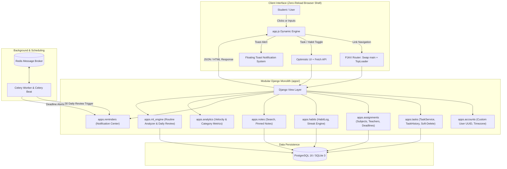
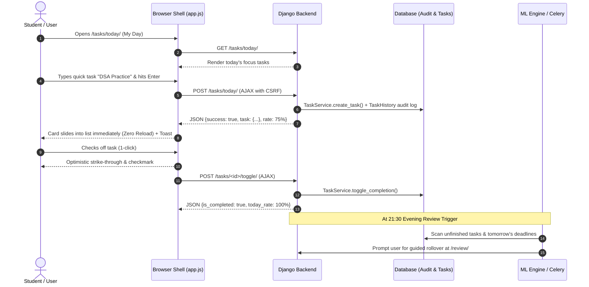

<div align="center">

# ⚡ My Habit Tracker

**Intelligent Personal Productivity, Academic Deadline Tracking & Hybrid ML Scheduling**

[](https://www.djangoproject.com/)
[](https://www.python.org/)
[](https://opensource.org/licenses/MIT)
[](https://tailwindcss.com/)
[](https://docs.celeryq.dev/)
[](https://scikit-learn.org/)
[](https://github.com/Yashendra-org/Ai_Powered_Task_Manager)

<p align="center">
  <a href="#-overview">Overview</a> •
  <a href="#-key-features">Key Features</a> •
  <a href="#-system-architecture">Architecture</a> •
  <a href="#-workflow">Workflow</a> •
  <a href="#-project-structure">Project Structure</a> •
  <a href="#-technology-stack">Tech Stack</a> •
  <a href="#-installation--setup">Setup</a> •
  <a href="#-api--view-routes">Routes</a> •
  <a href="#-testing--verification">Testing</a> •
  <a href="#-contributors">Contributors</a>
</p>

</div>

---

## 📌 Overview

**My Habit Tracker** is a distraction-free, personal productivity web platform designed specifically for students, self-improvers, and professionals. It unifies daily task prioritization, college assignment deadline management, recurring habit streak tracking, and machine learning routine discovery into one unified workspace.

Traditional to-do apps simply store tasks until they are manually checked off, leading to backlog fatigue, forgotten academic submissions, and abandoned habits. **My Habit Tracker** transforms this paradigm through rule-based automation, a hybrid recommendation engine, and an instantaneous zero-reload user interface.

### The Solution

My Habit Tracker bridges daily execution with long-term consistency through four core pillars:

- **"My Day" Focus Cockpit** — A dedicated daily focus view featuring sticky quick-task addition, live completion rate computation, and 1-click completion toggles that operate without refreshing the page.
- **College Assignment Hub** — Subject and professor directories with dynamic submission urgency categorization (`Due Today`, `Due Soon`, `Overdue`), coursework file uploads, and 1-click submission logs.
- **7-Day Habit Consistency Matrix** — Weekly interactive grid tracking consecutive streaks, daily completions, and visual consistency momentum across customizable frequencies.
- **Intelligent Assistant & Daily Review** — Hybrid recommendation system (routine frequency detection + deadline risk alerts + feedback loop) coupled with a 21:30 guided End-of-Day Review for seamless task rollover.

> [!NOTE]
> **Zero-Reload SPA Architecture**: The application incorporates a seamless client-side PJAX and AJAX engine. Task toggling, habit logging, assignment submission, note pinning, and sidebar page transitions occur instantaneously with zero white screen flashes or page reloads.

---

## ✨ Key Features

### 📅 Daily Task Management & "My Day"
| | Feature | Details |
|---|---|---|
| ☀️ | **"My Day" Focus View** | Focused daily cockpit displaying only tasks scheduled for today with real-time progress bars |
| ⚡ | **Zero-Reload Quick Add** | Sticky inline input bar that inserts newly created tasks directly into the DOM with smooth animations |
| 🔄 | **1-Click Completion Toggle** | Instant check/uncheck status switching with optimistic strike-through styling and recalculation |
| 🗂️ | **Multi-Criteria Task Filtering** | Filter "All Tasks" by status (`Pending`, `Completed`, `Overdue`), Category pills, Priority, and Search query |
| 🗑️ | **Soft-Delete & Trash Recovery** | Accidental deletions move tasks to Recently Deleted (`/tasks/trash/`) with 1-click restore |
| ⏱️ | **Audit History Tracking** | Automatic state logging (`TaskHistory`) recording all transitions for ML model training data |

### 🎓 College Assignment Manager
| | Feature | Details |
|---|---|---|
| 📚 | **Academic Subject Directory** | Course code and subject catalog (e.g. `CS302 — Data Structures`) with color-coded badges |
| 👨‍🏫 | **Instructor Directory** | Teacher contact registry linking office locations, emails, and assigned subjects |
| 🚨 | **Dynamic Urgency Badges** | Automated deadline categorizer highlighting `Due Today`, `Due Soon (<48h)`, and `Overdue` submissions |
| 📎 | **Coursework File Uploads** | Attach homework PDFs, code archives, or problem sets directly to assignment records |
| ✅ | **1-Click Submission Toggle** | Mark assignments as "Submitted" with timestamp logging (`submitted_at`) without page reloads |

### 🔥 Habit Tracker & Quick Notes
| | Feature | Details |
|---|---|---|
| 🗓️ | **7-Day Consistency Matrix** | Horizontal weekly grid (Mon–Sun) with instant check-off buttons for each active habit |
| 📈 | **Streak Counter Engine** | Real-time calculation of consecutive active days (`current_streak`) with milestone badges |
| 📝 | **Quick Notes Scratchpad** | Card-based notes repository with live full-text search and pin-to-top toggles |
| 🏷️ | **Custom Recurrence Schedules** | Daily, Weekday, Weekend, or custom-day recurring habit scheduling rules |

### 🧠 Smart Assistant & End-of-Day Review
| | Feature | Details |
|---|---|---|
| 🤖 | **Routine Detection Engine** | Scans historical `TaskHistory` to identify recurring weekly patterns and propose automatic task scheduling |
| ⚠️ | **Completion Likelihood Alerts** | Flags high-urgency tasks and assignments at risk of slipping past deadlines |
| 🌙 | **Guided Evening Review** | 21:30 daily recap view at `/review/` allowing 1-click rollover to tomorrow or cancellation |
| 💬 | **Accept / Reject Feedback Loop** | Feedback records (`accepted`, `rejected`) refine future suggestions and auto-create approved tasks |

### 📊 Unified Calendar & Productivity Analytics
| | Feature | Details |
|---|---|---|
| 🗓️ | **Unified Monthly Calendar** | Merges daily scheduled tasks, academic assignment deadlines, and habit completions into one interactive calendar |
| 📊 | **Chart.js Velocity Chart** | 7-day completion velocity bar chart illustrating daily output and productivity momentum |
| 🍩 | **Category Doughnut Chart** | Visual breakdown of time and tasks allocated across academic, personal, and work domains |
| 🔒 | **Multi-Tenant Data Isolation** | Strict `user=request.user` query scoping across all views preventing cross-account data leakage |

---

## 🧱 System Architecture



---

## 🔄 Workflow



---

## 📂 Project Structure

```
AI_powered_Task_Manager/
├── config/                          # Core project settings & configuration
│   ├── settings.py                  # Environment config, WhiteNoise, DB switch, Celery
│   ├── urls.py                      # Root URL routing table
│   ├── celery.py                    # Celery application & beat schedule definitions
│   ├── wsgi.py                      # Production WSGI application
│   ├── asgi.py                      # ASGI application
│   └── __init__.py
│
├── apps/                            # Modular domain applications
│   ├── accounts/                    # Custom User (UUID, Timezone, Review Time)
│   │   ├── models.py, views.py, urls.py, forms.py, admin.py, tests.py
│   │   └── management/commands/seed_dev_data.py
│   │
│   ├── tasks/                       # Core daily tasks & categories
│   │   ├── models.py                # Task, Category, TaskHistory (Audit)
│   │   ├── services.py              # TaskService business logic & state transitions
│   │   ├── views.py                 # My Day, All Tasks, Soft-Delete & Trash
│   │   ├── calendar_views.py        # Monthly unified calendar renderer
│   │   ├── forms.py, urls.py, admin.py, tests.py
│   │   └── migrations/
│   │
│   ├── assignments/                 # Academic assignment tracker
│   │   ├── models.py                # Subject, Teacher, Assignment, File Attachments
│   │   ├── views.py                 # Assignment hub, subject/teacher directory
│   │   ├── forms.py, urls.py, admin.py, tests.py
│   │   └── migrations/
│   │
│   ├── habits/                      # Recurring habit consistency & streaks
│   │   ├── models.py                # Habit, HabitLog
│   │   ├── views.py                 # 7-day weekly matrix, 1-click check-off
│   │   ├── forms.py, urls.py, admin.py, tests.py
│   │   └── migrations/
│   │
│   ├── notes/                       # Quick scratchpad notes
│   │   ├── models.py                # Note (pinned, markdown content)
│   │   ├── views.py                 # Searchable card grid, pin-to-top
│   │   └── forms.py, urls.py, admin.py, tests.py
│   │
│   ├── reminders/                   # In-app notifications & Celery alerts
│   │   ├── models.py                # Reminder, Notification
│   │   ├── views.py                 # Notification center, mark-as-read
│   │   └── urls.py, admin.py, tests.py
│   │
│   ├── analytics/                   # Productivity intelligence & Chart.js
│   │   ├── views.py                 # 7-day velocity chart, category breakdown
│   │   └── urls.py, admin.py, tests.py
│   │
│   └── ml_engine/                   # Hybrid recommendations & daily review
│       ├── models.py                # MLRecommendation, DailySummary
│       ├── services.py              # RecommendationEngine (Pattern Analysis)
│       ├── views.py                 # End-of-Day Review (/review/), Smart Assistant
│       └── urls.py, admin.py, tests.py
│
├── static/                          # Static assets
│   ├── css/main.css                 # Custom scrollbars, animations, design tokens
│   └── js/app.js                    # Seamless zero-reload engine & PJAX router
│
├── templates/                       # Semantic HTML5 UI templates
│   ├── base.html                    # Master layout with responsive sidebar & toast mount
│   ├── dashboard/index.html         # Executive overview dashboard
│   ├── accounts/                    # login.html, register.html, settings.html
│   ├── tasks/                       # my_day.html, all_tasks.html, trash.html, forms
│   ├── assignments/                 # list.html, subject_list.html, teacher_list.html
│   ├── habits/                      # list.html (7-day matrix), form.html
│   ├── notes/                       # list.html, form.html
│   ├── calendar/index.html          # Unified chronological calendar
│   ├── analytics/dashboard.html     # Chart.js velocity & breakdown graphs
│   ├── reminders/list.html          # In-app notification center
│   └── ml_engine/                   # review.html (End-of-Day Review), assistant.html
│
├── media/                           # User-uploaded coursework attachments
├── manage.py                        # Django CLI entrypoint
├── requirements.txt                 # Pinned dependencies
├── .env.example                     # Environment blueprint
├── .gitignore                       # Git ignore definitions
└── README.md                        # Master project documentation
```

---

## 🛠️ Technology Stack

<table>
<tr><td valign="top" width="25%"><b>Frontend & UI</b></td><td>

- **Tailwind CSS 3.4**: Clean, modern design system with curated slate/blue color palette
- **Vanilla JavaScript Engine (`app.js`)**: Zero-reload PJAX router, optimistic task toggles, and dynamic DOM injection
- **Lucide Icons**: Crisp, lightweight vector iconography
- **Chart.js**: Dynamic productivity velocity bar charts and category distribution doughnuts

</td></tr>
<tr><td valign="top"><b>Backend & Framework</b></td><td>

- **Python 3.11+ / 3.12**
- **Django 5.0 / 6.0**: Modular monolith architecture with strict service layers (`services.py`)
- **Django REST Framework**: Structured serialization and JSON response support

</td></tr>
<tr><td valign="top"><b>Machine Learning & Recommendations</b></td><td>

- **Scikit-Learn**: Historical task completion classifier and feature engineering pipeline
- **Pattern Analyzer**: Frequency and temporal pattern analysis for routine detection
- **Feedback Loop Engine**: User accept/reject tracking to iteratively refine confidence scores

</td></tr>
<tr><td valign="top"><b>Asynchronous Queue & Scheduling</b></td><td>

- **Celery 5.4**: Distributed task queue handling scheduled notifications and daily review triggers
- **Redis 7**: High-performance in-memory message broker and caching layer

</td></tr>
<tr><td valign="top"><b>Database & Persistence</b></td><td>

- **SQLite 3**: Zero-configuration default for local development
- **PostgreSQL 16**: Production-ready relational storage configured via environment variables
- **Audit Logging**: `TaskHistory` and `HabitLog` tracking all temporal state transitions

</td></tr>
<tr><td valign="top"><b>Security & Tenant Isolation</b></td><td>

- **Tenant Isolation**: Mandatory `user=request.user` query filtering across all 8 modules
- **CSRF & XSS Defense**: Django CSRF token verification on all asynchronous requests
- **Cryptographic Hashing**: Secure Argon2 / PBKDF2 password protection

</td></tr>
</table>

---

## ⚙️ Installation & Setup

### 🔹 1. Clone the repository

```bash
git clone https://github.com/Yashendra-org/Ai_Powered_Task_Manager.git
cd Ai_Powered_Task_Manager
```

### 🔹 2. Create and activate a virtual environment

```bash
# Windows (PowerShell)
python -m venv .venv
.\.venv\Scripts\Activate.ps1

# macOS / Linux
python -m venv .venv
source .venv/bin/activate
```

### 🔹 3. Install dependencies

```bash
pip install -r requirements.txt
```

### 🔹 4. Configure environment variables

Create a `.env` file in the root directory (or copy `.env.example`):

```bash
cp .env.example .env
```

Your `.env` file can be configured as follows:
```env
SECRET_KEY=your-secure-random-secret-key
DEBUG=True
ALLOWED_HOSTS=127.0.0.1,localhost
DATABASE_URL=sqlite:///db.sqlite3
CELERY_BROKER_URL=redis://127.0.0.1:6379/0
DEFAULT_TIMEZONE=Asia/Kolkata
```

### 🔹 5. Run database migrations & seed development data

```bash
# Apply database migrations across all 8 applications
python manage.py migrate

# Seed sample academic courses, assignments, habits, and tasks
python manage.py seed_dev_data
```
> **Default Test Account:**
> - **Username:** `student`
> - **Password:** `password123`

### 🔹 6. Start the local development server

```bash
python manage.py runserver
```

Open [http://127.0.0.1:8000/](http://127.0.0.1:8000/) in your browser.

---

## 🚀 Deployment Guide (Render)

This repository is pre-configured and production-ready for instant deployment on [Render](https://render.com).

### 🔹 Option A: 1-Click Blueprint Deployment (Recommended)
1. Fork or push this repository to your GitHub account: `https://github.com/Yashendra-org/Ai_Powered_Task_Manager.git`.
2. Log in to [Render Dashboard](https://dashboard.render.com).
3. Click **New +** → **Blueprint**.
4. Select your `Ai_Powered_Task_Manager` repository.
5. Render reads [render.yaml](render.yaml) and automatically creates:
   - **PostgreSQL Database** (`task-manager-db`)
   - **Django Web Service** (`ai-powered-task-manager`)
   - Auto-wires the `DATABASE_URL` environment variable.
6. Click **Apply**. Render will automatically run `./build.sh` (installs requirements, collects static files via WhiteNoise, applies migrations, and seeds demo data), then start Gunicorn.

---

### 🔹 Option B: Manual Web Service Deployment
If you prefer setting up services manually on Render:

1. **Create PostgreSQL Database on Render:**
   - Go to **New +** → **PostgreSQL**.
   - Name: `task-manager-db` (Free tier).
   - Once provisioned, copy the **Internal Database URL**.

2. **Create Web Service on Render:**
   - Go to **New +** → **Web Service**.
   - Connect your GitHub repository `Ai_Powered_Task_Manager`.
   - Configure the following settings:
     - **Name:** `ai-powered-task-manager`
     - **Region:** Same region as your database (e.g., Oregon or Frankfurt).
     - **Branch:** `main`
     - **Runtime:** `Python`
     - **Build Command:** `./build.sh`
     - **Start Command:** `gunicorn config.wsgi:application --workers 2 --bind 0.0.0.0:$PORT`
     - **Instance Type:** `Free`

3. **Configure Environment Variables in Render:**
   In your Web Service settings under **Environment**, add:
   | Key | Value | Notes |
   |---|---|---|
   | `PYTHON_VERSION` | `3.12.0` | Recommended Python runtime |
   | `DJANGO_SETTINGS_MODULE` | `config.settings` | Django settings path |
   | `SECRET_KEY` | *(Click "Generate")* | Cryptographic signing key |
   | `DEBUG` | `false` | Production mode |
   | `ALLOWED_HOSTS` | `.onrender.com,localhost,127.0.0.1` | Host routing |
   | `DATABASE_URL` | *(Paste Internal DB URL)* | Render PostgreSQL connection string |
   | `WEB_CONCURRENCY` | `2` | Gunicorn worker threads |
   | `TIME_ZONE` | `Asia/Kolkata` | Local timezone |
   | `SEED_DEV_DATA` | `true` | Seeds initial student account & sample habits |

4. **Click Deploy:**
   Render will build the project, run migrations, collect static assets, and launch your live application at `https://<your-subdomain>.onrender.com`.

> **Initial Login on Render:**
> - **Username:** `student`
> - **Password:** `password123`

---

## 📡 API & View Routes

Base URL: `/`

| Method | URL Path | View Controller | Access | Description |
|---|---|---|---|---|
| `GET` | `/` | `apps.tasks.views.dashboard_view` | Auth | Executive dashboard with metrics & focus tasks |
| `GET`, `POST` | `/tasks/today/` | `apps.tasks.views.my_day_view` | Auth | My Day focus cockpit with zero-reload quick-add |
| `GET` | `/tasks/` | `apps.tasks.views.all_tasks_view` | Auth | Searchable task list with category & priority filters |
| `POST` | `/tasks/<id>/toggle/` | `apps.tasks.views.task_toggle_complete_view` | Auth | Instant check/uncheck status toggle (AJAX) |
| `POST` | `/tasks/<id>/delete/` | `apps.tasks.views.task_delete_view` | Auth | Soft-delete task to Recently Deleted (AJAX) |
| `GET` | `/tasks/trash/` | `apps.tasks.views.trash_view` | Auth | Recently Deleted task manager with restore |
| `GET` | `/assignments/` | `apps.assignments.views.assignment_list_view` | Auth | College Assignment Hub with urgency filters |
| `POST` | `/assignments/<id>/submit-toggle/` | `apps.assignments.views.assignment_toggle_submission_view` | Auth | 1-Click assignment submission toggle (AJAX) |
| `GET` | `/habits/` | `apps.habits.views.habit_list_view` | Auth | 7-Day Consistency Matrix with streak counters |
| `POST` | `/habits/<id>/log/` | `apps.habits.views.habit_toggle_log_view` | Auth | 1-Click daily habit check-off (AJAX) |
| `GET` | `/calendar/` | `apps.tasks.calendar_views.calendar_view` | Auth | Unified chronological calendar |
| `GET` | `/analytics/` | `apps.analytics.views.analytics_dashboard_view` | Auth | Chart.js 7-day velocity and category analytics |
| `GET` | `/review/` | `apps.ml_engine.views.end_of_day_review_view` | Auth | End-of-Day Review workflow with guided rollover |
| `GET` | `/assistant/` | `apps.ml_engine.views.smart_assistant_view` | Auth | ML suggestions with accept/reject feedback loop |
| `POST` | `/assistant/feedback/<id>/<action>/` | `apps.ml_engine.views.recommendation_feedback_view` | Auth | Record feedback & auto-create approved tasks |
| `GET` | `/notes/` | `apps.notes.views.note_list_view` | Auth | Searchable scratchpad notes repository |
| `GET`, `POST` | `/login/`, `/register/` | `apps.accounts.views` | Public | Authentication & account registration |

---

## 🧪 Testing & Verification

The platform maintains an automated test suite verifying CRUD operations, multi-tenant isolation, AJAX envelopes, and business services across all 8 modules.

```bash
# Execute the full automated test suite
python manage.py test
```

### Test Suite Results:
```text
Creating test database for alias 'default'...
...................................
----------------------------------------------------------------------
Ran 35 tests in 45.422s

OK
Destroying test database for alias 'default'...
Found 35 test(s).
System check identified no issues (0 silenced).
```

---

## 👥 Contributors

<table>
<tr><th>Contributor</th><th>Role</th><th>Key Responsibilities</th></tr>
<tr>
<td><b>Yashendra Kumar</b></td>
<td>Lead Architect & Full-Stack Engineer</td>
<td>System architecture, Django modular backend, database schema, zero-reload PJAX/AJAX client engine, ML recommendation layer, and test suite.</td>
</tr>
</table>

---

## 🧭 Roadmap

- [ ] **Voice-to-Task Transcription** — Rapid voice input converted to categorized tasks using Web Speech API.
- [ ] **WhatsApp & Telegram Reminders** — Two-way bot integration for receiving morning agendas and checking off habits via chat.
- [ ] **Pomodoro Focus Timer** — Built-in 25-minute timer integrated with task time tracking and productivity reports.
- [ ] **Offline ML Retraining Pipeline** — Standalone scheduled job retraining Random Forest classifiers on accumulated `TaskHistory` data.

---

## 📜 License

This project is open-source software licensed under the **[MIT License](LICENSE)**.

---

<div align="center">
<h3>⚡ "Plan with Clarity, Execute with Focus, Build Unbreakable Consistency."</h3>
</div>
